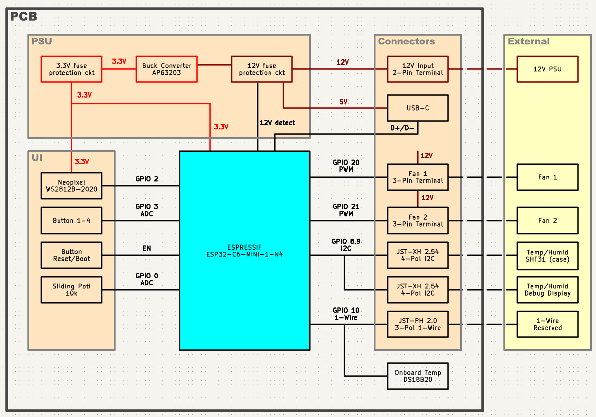

# home-fan

Open hardware controller for two reversing 12 V PWM fans, built around an ESP32-C6.

Replaces the electronics of an **inVENTer® iV14** decentralised ventilation system: the wall sleeve, ducting and covers stay, the original fans and the 24 V controller are replaced by two ebm-papst 4412FGMPR fans and this board. It fits the older square 120 × 120 mm fan sleeves, not the newer round iV14R / iV14V units. It is **not** electrically compatible with the original controller (e.g. sMove) or fans: inVENTer uses voltage control, this board uses 3-wire PWM fans.

This project is not affiliated with or endorsed by inVENTer GmbH and contains no files, firmware or documentation from them.

**Status:** schematics and parts selection done. PCB layout is next. Nothing has been ordered or tested yet, so do not build this board yet.

## Why

The original fans get old and noisy (bearing wear), and replacing several of them at original prices adds up quickly. Rough list prices as of 2026:

| Part          | Original      | This project, DIY                                  | This project, fully ordered |
|---------------|---------------|----------------------------------------------------|-----------------------------|
| Fan, per room | ~330 EUR      | ~60 EUR (ebm-papst 4412FGMPR)                       | ~60 EUR                     |
| Controller    | ~250 EUR      | PCB, SMD by JLCPCB, THT DIY            | PCB fully assembled, price follows |
| Case          | included      | 3D printed yourself                                | printed by JLCPCB, price follows |
| Power supply  | included      | ~20 EUR (12 V PSU)                           | ~20 EUR                |

DIY means you solder the handful of through-hole connectors on the back and print the case yourself. If you have neither a soldering iron nor a printer, JLCPCB can do both, it just costs more. Prices for the board and case follow once the first batch is ordered.

The design is public so that anyone in the same situation can inspect it, point out mistakes, and build their own. Everything is sourced so that one supplier (JLCPCB) can deliver the whole thing.

## The fan: ebm-papst 4412FGMPR

The fan is the reason this project exists. It fits the old square 120 × 120 mm sleeve exactly and costs about 60 EUR (e.g. at RS Components).

- 119 × 119 × 25 mm, 12 V DC, 3.4 W (~0.3 A), 137 m³/h, 37 dB(A)
- Type suffix decoded:
  - **F**: slim 25 mm variant of the 4400 series
  - **G**: sleeve bearing (Gleitlager)
  - **M**: speed class medium
  - **P**: PWM input
  - **R**: reversible. This is the critical letter. Without **R** the fan cannot change direction and will not work for push-pull ventilation.

## The controller

The original inVENTer controller is replaced completely, nothing of it is reused.

### Push / pull design

The controller is designed for one or two fans. With two fans, one blows in while the other blows out, then both reverse. Depending on the cables already in your wall there are two ways to get there:

**Individual cabling**  
The controller has two fan outputs and runs the two fans individually, each in its own direction. Both fans are mounted the same way.

**Daisy chain**  
If your fans are connected by a single cable, going into fan 1 and on to fan 2, use one fan output and mechanically flip one of the fans so it blows the other way. Either fan output supports that.

## What it does

- Runs two reversing fans in push / pull: one blows out for 70 s while the other pulls in, then both switch
- Two SHT31 temperature / humidity sensors over I2C, one in the housing and one in the second room (~5 m away, shielded / twisted cable). Meant for bathrooms: when humidity rises above roughly 80 %, the fans go to 100 % until it drops again
- DS18B20 temperature sensor to monitor internal components (PSU, PCB) in the wall. 
- USB-C for flashing and debugging. The board also runs from USB alone, at reduced LED brightness, so you can develop on the desk without the 12 V supply
- ESP32-C6 with Wi-Fi, Bluetooth, Zigbee and Thread. The stock firmware does not use any of it: no network, one fan in, one fan out, nothing that can crash. Home Assistant or house-wide synchronisation is possible if you want to tinker yourself.

### Operating it

Two ways to set the fan speed, pick one or both when printing the cover plate:

- **Slide potentiometer**: continuous speed. Sticks out of the cover, optional (~3.5 eur). 
- **Four buttons**: fixed steps, e.g. off / 20 % / 50 % / 100 %. Flat profile.
- **10x RGB-LEDs** (WS2812B): shine-through the housing, invisible when deactivated.

### Debug display

A third I2C port on the bottom of the board takes a small I2C display. Plug it in and it shows the sensor readings, so someone without a laptop can check why a fan behaves the way it does (fan at 100 % all the time? The display shows 100 % humidity, so a sensor is probably broken). Not needed for normal operation.

## Block diagram



Block Diagram is outdated. 

## Hardware overview

| Block          | Parts                                                                                       |
|----------------|---------------------------------------------------------------------------------------------|
| MCU            | ESP32-C6-MINI-1-N4 (4 MB flash). The -H8 (8 MB) is pin compatible, swap the LCSC number in the BOM if you need it (~4 eur -> ~11 eur) |
| Power input    | 2-pin screw terminal, 12 V. Protected so a wiring mistake should not kill the board: SS34 diode against swapped + and -, 1.1 A fuse, SMAJ15A TVS that shorts anything above ~16 V (e.g. the original 24 V PSU) and blows the fuse. Not tested yet |
| 3.3 V rail     | AP63203 buck converter, 2 A. 12 V and USB 5 V are diode-OR'ed into the buck, so either source works |
| USB-C          | Flashing, debugging and desk power. USBLC6-2SC6 ESD protection. A 12 V sense line tells the firmware whether it runs on USB only |
| Fan outputs    | 2 × 3-pin screw terminal (PWM, 12 V, GND)                                                    |
| PC fan headers | 2 × 4-pin PC fan header in parallel with the screw terminals, with tacho input (optional)   |
| Buttons        | 4 × 6 × 6 mm tactile switches, plus reset and boot buttons                                   |
| Slider         | Bourns PTA3043, 10 kΩ, 30 mm travel (optional)                                                         |
| LEDs           | 10 × WS2812B-2020                                                                            |
| I2C            | 3 × JST-XH 2.54 mm 4-pin: two SHT31 sensors, one debug display                               |
| 1-Wire         | DS18B20 on board plus JST-PH 2.0 mm 3-pin for an external sensor (1-Wire supports long cables). (optional) |
| Expansion      | 2 × 7 pin header J11. One row matches the pinout of the common cheap SPI displays (GND, 3V3, IO4, IO5, TXD0, RXD0, 3V3) so one can be soldered straight on. The other row breaks out 3V3, SDA, SCL, 1-Wire, WS2812B data out and both tacho lines for more LEDs, sensors or analog inputs (optional) |
| PCB            | 4 layers. SMD parts on the front, through-hole connectors on the back                       |

Every connector type is used only once (2-pin and 3-pin screw terminals, 2.54 mm JST-XH, 2.0 mm JST-PH, USB-C), so nothing fits in the wrong place.

### GPIO assignment

| GPIO | Function         | GPIO | Function           |
|------|------------------|------|--------------------|
| IO0  | Slider (ADC)     | IO12 | USB D-             |
| IO1  | 12 V sense (ADC) | IO13 | USB D+             |
| IO2  | Fan 1 tacho / J11 | IO14 | 1-Wire            |
| IO3  | Fan 2 tacho / J11 | IO15 | spare             |
| IO4  | J11 (display)    | IO18 | Fan 1 PWM          |
| IO5  | J11 (display)    | IO19 | Fan 2 PWM          |
| IO6  | I2C SDA          | IO20 | Button 1           |
| IO7  | I2C SCL          | IO21 | Button 2           |
| IO8  | WS2812B data     | IO22 | Button 3           |
| IO9  | Boot button      | IO23 | Button 4           |

EN goes to the reset button, RXD0 / TXD0 are on J11 and on test points.

## Alternative use: PC fan controller

The board also carries two standard 4-pin PC fan headers wired in parallel with the screw terminals, plus tacho inputs for both. With a cheap SPI display soldered onto J11, it works as a stand-alone controller for ordinary PC fans. It costs almost no board space and gives the PCB a second life outside the wall.

## Roadmap

- [x] Schematics
- [x] Part selection, every part with an LCSC number for JLCPCB assembly in the KiCac BOM
- [ ] Update block diagram
- [ ] PCB layout (4 layers)
- [ ] 3D printed case (FreeCAD), cover plate variants with and without slider
- [ ] Design review before ordering
- [ ] Order PCB and parts, build first unit
- [ ] Test, fix, reorder if needed
- [ ] Firmware in Rust
- [ ] Install in the house
- [ ] Price list for board and case

## Repository structure

```txt
.
├── home-fan.kicad_pro          KiCad 10 project
├── home-fan.kicad_sch          Root sheet
├── ESP32-C6-1.kicad_sch        Sheet: ESP32-C6 and PSU
├── ESP32-C6-2.kicad_sch        Sheet: ESP32-C6 peripherals
├── BlockDiagram.kicad_sch      Block diagram (outdated)
├── home-fan.kicad_pcb          PCB layout (empty so far)
├── sym-lib-table               Project symbol libraries
├── fp-lib-table                Project footprint libraries
├── lib/                        One library per LCSC part: symbol, footprint, 3D model
├── production/                 Gerber, BOM, CPL for JLCPCB (empty so far)
├── case/                       FreeCAD case (empty so far)
├── firmware/                   Rust firmware (empty so far)
├── datasheets/                 Datasheets are linked by URL in the schematic, not stored here
└── docs/                       Documentation and images
```

## Tools

- [KiCad](https://www.kicad.org/) 10 for schematic and PCB
- [FreeCAD](https://www.freecad.org/) 1.0 / 1.1 for the case
- [easyeda2kicad](https://github.com/uPesy/easyeda2kicad.py) to pull symbols, footprints and 3D models from LCSC, see [docs/kicad-lcsc-library.md](docs/kicad-lcsc-library.md)
- [Rust](https://www.rust-lang.org/) with [esp-hal](https://github.com/esp-rs/esp-hal) for the firmware

## Parts and ordering

- [JLCPCB](https://jlcpcb.com/) for PCB, assembly and 3D printing
- [JLCPCB Parts](https://jlcpcb.com/parts) and [LCSC](https://www.lcsc.com/) for part selection. Parts marked `Extended` cost about 3 EUR extra per type for assembly
- Fan: ebm-papst 4412FGMPR, e.g. from [RS Components](https://uk.rs-online.com/web/p/axial-fans/1917807)

## Safety

The board itself runs on 12 V, which is harmless. The 12 V power supply connects to mains. Use a ready-made, certified PSU and have the mains side done by someone qualified if you are not.

## License

Hardware (schematics, PCB, case) is licensed under the [CERN-OHL-P v2](LICENSE). In short: do what you want with it, keep the notice, and do not blame me if it burns down. The firmware will get its own license once it exists.

## Disclaimer

Everything here is in development. Nothing has been built or tested yet, and there may be bigger changes to any part of this project before it is done.
